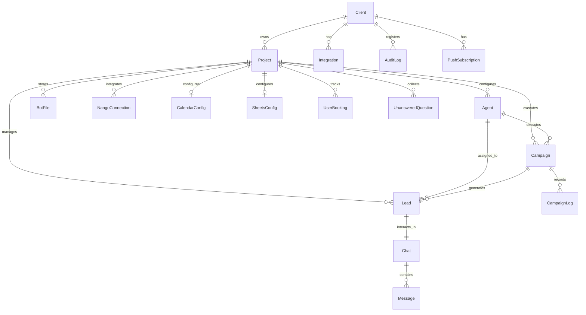
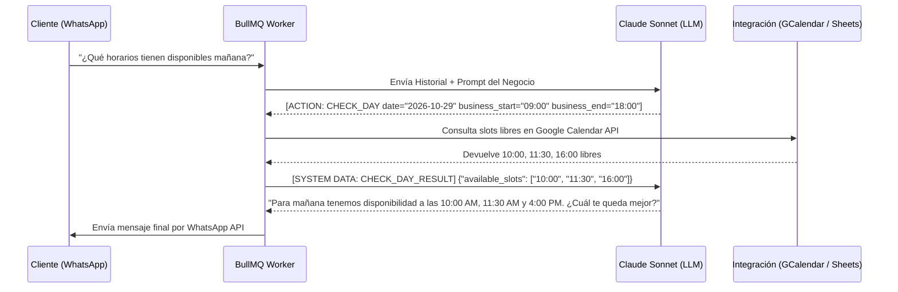

# Documentación Integral de Arquitectura y Contexto de la Plataforma - Abita AI

> **Última actualización:** Octubre 2026  
> **Versión de plataforma:** 0.1.0 (Next.js 16 + React 19 + Claude 3.5/Sonnet + Gemini 3.8 Flash)  
> **Propósito:** Guía maestra de contexto técnico, arquitectura lógica, flujos de datos y módulos funcionales para desarrolladores, agentes de IA y operadores de sistema.

---

## 1. Visión General del Producto

**Abita AI** es una plataforma SaaS de automatización conversacional y calificación de prospectos diseñada para flujos de venta consultivos y de alto valor (como bienes raíces, clínicas especializadas, automotriz y servicios profesionales).

A diferencia de los chatbots tradicionales basados en árboles de decisión rígidos o RAG básico:
1. **Actúa como un agente inteligente autónomo** con memoria conversacional, capacidad de razonamiento profundo y personalidad de marca humana.
2. **Ejecuta acciones en el mundo real en tiempo real (Agentic Tool Calling):**
   - Consulta disponibilidad y agenda citas en **Google Calendar**.
   - Consulta catálogos y datos privados en **Google Sheets**.
   - Envía folletos, catálogos y multimedia vía WhatsApp con **BotFiles**.
   - Transfiere a asesores humanos instantáneamente (**Handoff**) notificando por WhatsApp, Email y Web Push.
   - Califica prospectos automáticamente en una escala térmica de 0 a 100 (**Lead Scoring / Heatmap**).
   - Auto-aprende recopilando preguntas no respondidas para reentrenamiento continuo.

---

## 2. Arquitectura Lógica de Alto Nivel

El siguiente diagrama detalla el flujo de información desde la interacción del usuario en WhatsApp/Instagram hasta la ejecución del modelo y la sincronización con la base de datos y la interfaz de usuario:

```mermaid
flowchart TD
    subgraph Canales_Externos [Canales de Entrada]
        WA[Meta WhatsApp Cloud API]
        IG[Meta Instagram Graph API]
    end

    subgraph Ingestion_Layer [Capa de Ingestión y Seguridad]
        WH_WA[/api/webhooks/whatsapp]
        WH_IG[/api/webhooks/instagram]
        SEC[HMAC SHA-256 + Rate Limiter Redis + Idempotencia WebhookEvent]
    end

    subgraph Queue_Debounce [Capa Asíncrona & Buffer]
        REDIS[(Redis Buffer)]
        DEBOUNCE[Sliding Debounce Window 6s]
        BULLMQ[BullMQ Message Queue]
    end

    subgraph Worker_Engine [Motor Asíncrono: run-worker.ts]
        WORKER[BullMQ Worker Service]
        TRANSCRIBE[Audio Transcribe: Gemini 3.8 Flash + FFmpeg]
        VISION[Multimodal Vision: Claude / Base64 Image Fetch]
        SUB_CHECK[Verificación de Límites de Mensajes]
    end

    subgraph AI_Orchestration [Orquestador de IA: chat.ts]
        PROMPT_BUILDER[Dynamic Prompt Builder: Bloques DB + Contexto]
        LLM_PRIMARY[Claude Sonnet 3.5 / 5]
        LLM_FALLBACK[Gemini 3.8 Flash Fallback]
        LOOP[Bucle Agéntico Tool Loop: Max 5 Iteraciones]
    end

    subgraph Integraciones [Integraciones & Herramientas: Nango / API]
        GCAL[Google Calendar API: Disponibilidad & Reservas]
        GSHEETS[Google Sheets API: Catálogos & BD Clientes]
        FILES[BotFiles: Storage Supabase]
    end

    subgraph Data_Layer [Capa de Persistencia: PostgreSQL Supabase]
        PRISMA[Prisma ORM]
        DB[(PostgreSQL DB)]
    end

    subgraph Notificaciones [Notificaciones en Tiempo Real]
        WEBPUSH[Web Push API]
        RESEND[Resend Email Alerts]
        WANOTIF[WhatsApp Alerts al Staff]
    end

    subgraph Frontend_App [Aplicación Web Next.js 16]
        INBOX[Inbox Omnicanal con Polling / Sincronización]
        LEADS[CRM & Heatmap Leads]
        CAMPAIGNS[Lanzador de Campañas Meta]
        SETTINGS[Configurador de Agente & Knowledge Base]
        ADMIN[Master Control Super Admin]
    end

    %% Flujos
    WA --> WH_WA
    IG --> WH_IG
    WH_WA --> SEC
    WH_IG --> SEC
    SEC --> REDIS
    REDIS --> DEBOUNCE
    DEBOUNCE --> BULLMQ
    BULLMQ --> WORKER

    WORKER --> TRANSCRIBE
    WORKER --> VISION
    WORKER --> SUB_CHECK
    WORKER --> PROMPT_BUILDER

    PROMPT_BUILDER --> LLM_PRIMARY
    LLM_PRIMARY -. Error .-> LLM_FALLBACK
    LLM_PRIMARY --> LOOP
    LLM_FALLBACK --> LOOP

    LOOP <--> GCAL
    LOOP <--> GSHEETS
    LOOP <--> FILES

    LOOP --> PRISMA
    PRISMA --> DB

    WORKER --> WEBPUSH
    WORKER --> RESEND
    WORKER --> WANOTIF
    WORKER --> WA
    WORKER --> IG

    DB <--> Frontend_App
```

---

## 3. Pila Tecnológica (Tech Stack)

| Capa | Tecnología | Propósito |
| :--- | :--- | :--- |
| **Framework Web** | [Next.js 16](https://nextjs.org/) (App Router, Server Actions, Route Handlers) | Framework fullstack reactivo y optimizado para producción. |
| **Librería UI** | [React 19](https://react.dev/) + TypeScript 5 | Componentes desacoplados, interfaces tipadas y concurrencia. |
| **Estilos & Diseño** | [Tailwind CSS v4](https://tailwindcss.com/) + Radix UI + Lucide Icons | Estética moderna, modo oscuro/claro nativo (`next-themes`), micro-animaciones. |
| **Base de Datos** | [PostgreSQL](https://www.postgresql.org/) hospedado en **Supabase** | Persistencia relacional ACID, conexión directa y pooler. |
| **ORM** | [Prisma ORM 5.22](https://www.prisma.io/) | Modelado de datos, migraciones tipadas e indexación. |
| **Colas & Debounce** | [BullMQ 5](https://docs.bullmq.io/) + [IORedis](https://github.com/redis/ioredis) | Buffer de ráfagas de mensajes (debounce de 6 segundos), colas de ejecución asíncrona. |
| **Cerebro IA Primario**| [Anthropic Claude Sonnet](https://www.anthropic.com/claude) (`claude-sonnet-5-5`) | Comprensión contextual, ejecución de acciones XML, empatía y razonamiento. |
| **Cerebro IA Secundario**| [Google Gemini Flash](https://deepmind.google/technologies/gemini/) (`gemini-3.8-flash`) | Fallback de alta velocidad, transcripción de notas de voz en tiempo real y resúmenes. |
| **Audio & Multimedia**| `fluent-ffmpeg` + `@ffmpeg-installer/ffmpeg` + Supabase Storage | Procesamiento de audio WhatsApp (.ogg/opus), conversión y almacenamiento de archivos. |
| **Autenticación** | [NextAuth.js v4](https://next-auth.js.org/) + BCrypt | Sesiones seguras basadas en JWT y credenciales, protección contra fuerza bruta y RBAC. |
| **Seguridad Web** | [Cloudflare Turnstile](https://www.cloudflare.com/products/turnstile/) | Captcha invisible sin fricción para prevenir ataques automatizados al login. |
| **Integraciones Externas**| [Nango HQ](https://www.nango.dev/) | Conectividad OAuth gestionada con Google Calendar y Google Sheets. |
| **Email Transaccional**| [Resend](https://resend.com/) | Envío de notificaciones inmediatas de handoff hacia el equipo del cliente. |
| **Push Notifications**| `web-push` (Service Worker) | Alertas nativas de navegador para nuevos mensajes y transferencias a humanos. |
| **Caché & SWR** | [SWR 2.5](https://swr.vercel.app/) + Redis | Stale-while-revalidate por dispositivo, prefetch en navegación y caché de integraciones. |
| **Observabilidad** | `@sentry/nextjs` | Trazabilidad de errores en el servidor, edge y cliente. |


---

## 4. Modelo de Datos y Dominio (Prisma Schema)

La arquitectura de datos está jerárquicamente estructurada para soportar **multi-tenancy** estricto:



### Entidades Principales

1. **`Client` (Cuenta Empresarial / Suscripción)**:
   - Representa al suscriptor del SaaS.
   - Campos clave: `email`, `role` (`CLIENT` o `ADMIN`), `subscriptionStatus` (`ACTIVE`, `INACTIVE`, `BLOCKED`), `messageLimit` (cuota mensual), `subscriptionResetDay` (día de corte para reinicio de conteo), `failedLoginAttempts`.
2. **`Project` (Espacio de Trabajo / Sucursal)**:
   - Aislador de contexto operativo. Cada cliente tiene sus proyectos (ej. diferentes marcas o proyectos inmobiliarios).
   - Credenciales de WhatsApp: `whatsappBusinessId`, `whatsappPhoneId`, `whatsappToken` (cifrado con AES-256).
   - Banderas: `defaultBotActive`, `leadScoringEnabled`, `botAutoWakeHours` (tiempo para reactivar el bot tras abandono humano).
3. **`Agent` (Instancia del Agente Virtual)**:
   - Modela la personalidad y reglas de negocio del bot asignado al proyecto.
   - Contiene: `identity`, `instructions`, `knowledgeData` (JSON compilado), `knowledgeRaw` (texto original sin procesar), `faq`, `leadScoringRules` (JSON de reglas de puntuación), `handoffRules`.
4. **`Lead` (Prospecto / Contacto del CRM)**:
   - Datos del cliente final: `phone` (clave única normalizada junto con `projectId`), `name`, `status` (`PENDING`, `QUALIFIED`, etc.), `score` (0 a 100), `heat` (`FRIO`, `TIBIO`, `CALIENTE`), `aiSummary`, `metadata` (JSON libre).
5. **`Chat` (Canal de Conversación)**:
   - Conexión 1 a 1 con el `Lead`.
   - Banderas críticas: `botActive` (control de IA vs control humano), `autoWakeBot` (si se reactiva solo), `disabledDueToLimit` (desactivado por exceder cuota mensual).
6. **`Message` (Historial de Mensajes)**:
   - Mensajes intercambiados: `role` (`user`, `assistant`, `agent`, `system`), `content`, `wamid` (WhatsApp Message ID único), `status` (`SENT`, `DELIVERED`, `READ`, `FAILED`), `scoreBump`, `scoreReason`, `inputTokens`, `outputTokens`, `waCategory` (`SERVICE`, `MARKETING`, `UTILITY`).
7. **`BotFile` (Catálogo Multimedia)**:
   - Documentos o imágenes subidas por el cliente (PDFs de planos, fotos de amenidades, listas de precios).
   - La IA los referencia por ID o nombre descriptivo para despacharlos en el chat.
8. **`NangoConnection` & `CalendarConfig` / `SheetsConfig`**:
   - Conectores OAuth a Google Calendar y Google Sheets.
   - Manejan sincronización de slots, duraciones de citas (`durationMinutes`), campos requeridos (`fieldsToCollect`) y tablas autorizadas.
9. **`UnansweredQuestion`**:
   - Almacena preguntas que el bot no pudo contestar con su base de conocimiento actual, permitiendo al administrador responderlas y reentrenar al agente en 1 clic.
10. **`BotTestSuite`**:
    - Resultados de simulaciones de pruebas y evaluaciones automatizadas contra el bot.

---

## 5. Flujo de Vida del Mensaje (Inbound & Outbound)

### Paso 1: Recepción en Webhook (`/api/webhooks/whatsapp/route.ts`)
1. **Seguridad y Verificación:**
   - Valida el token de webhook (`hub.verify_token`) en solicitudes `GET`.
   - Valida la firma criptográfica `x-hub-signature-256` utilizando HMAC-SHA256 con `META_APP_SECRET` en solicitudes `POST`.
2. **Rate Limiting e Idempotencia:**
   - Rate limit por IP en Redis (máximo 1,000 req/min por IP).
   - Verificación de duplicados en `WebhookEvent` (`id` compuesto por `message.id` o `status.id-status`). Si el evento ya existe, se descarta con HTTP 200 para evitar procesamiento doble.
3. **Normalización Telefónica:**
   - La función `normalizePhone` elimina discrepancias de formato regional (ejemplo: prefijos móviles mexicanos `521...` vs `52...`).
4. **Descarga de Multimedia:**
   - Si el mensaje incluye audio, imagen o documento, se descarga desde la API de Meta (`downloadAndUploadMetaMedia`) y se almacena en el bucket de Supabase Storage para disponer de URLs públicas persistentes.

### Paso 2: Buffer de Debounce en Redis (`src/lib/queue.ts`)
Los usuarios humanos en WhatsApp suelen enviar múltiples mensajes fragmentados en ráfagas consecutivas:
> "Hola"  
> "¿Tienen citas para mañana?"  
> "A las 4pm por favor"

Para evitar que la IA responda tres veces generando mensajes cruzados y gastos innecesarios de tokens:
- Cada mensaje entrante se inserta con `LPUSH` en una lista de Redis `buffer:${phone}`.
- Se programa un trabajo en **BullMQ** con un retraso (debounce) de **6 segundos**.
- Si entra un nuevo mensaje del mismo número antes de que expiren los 6 segundos, el trabajo previo se cancela y se reinicia el temporizador de 6 segundos.
- Si el bot está inactivo (`botActive === false`), el retraso es **0 ms** para reflejar el mensaje en el Inbox humano inmediatamente.

### Paso 3: Procesamiento Asíncrono en Worker (`src/lib/worker.ts`)
1. El worker de BullMQ extrae todos los mensajes acumulados en `buffer:${phone}` con `LRANGE` y los borra atómicamente.
2. **Transcripción de Voz:** Si el usuario envió una nota de voz (`audio/ogg`), se procesa con `transcribeAudioWithGemini` (Gemini 3.8 Flash), traduciendo el audio a texto antes de alimentar al LLM.
3. **Persistencia en Base de Datos:** Se insertan los mensajes del usuario en la tabla `Message` vinculada al `Chat`.
4. **Comprobación de Suscripción:** Se verifica si el cliente excedió su cuota mensual (`hasExceededLimit`). Si la excedió, el bot se desactiva automáticamente con `disabledDueToLimit: true` y no invoca a la IA.
5. **Invocación a la IA:** Si el bot está activo, se llama a `sendTestMessage` en `src/app/actions/chat.ts`.

---

## 6. Motor de Inteligencia Artificial (AI Brain & Agentic Loop)

El núcleo de razonamiento se encuentra en [src/app/actions/chat.ts](file:///c:/Users/danie/Desktop/Antigravity/abitaai/src/app/actions/chat.ts).

### 6.1 Construcción Dinámica del Prompt (`buildSystemPrompt`)
El system prompt no está cableado en código duro. Se construye combinando registros de la tabla `PromptBlock` (gestionable desde el panel Admin):
1. **Identidad del Agente (`client_identity`):** Nombre, rol, personalidad y tono.
2. **Contexto del Lead (`client_context`):** Nombre del prospecto, teléfono, fecha y hora local actual de Guatemala/Centroamérica (`America/Guatemala`).
3. **Knowledge Base (`client_knowledge`):** JSON estructurado compilado con datos oficiales del cliente.
4. **FAQ (`client_faq`):** Preguntas y respuestas frecuentes.
5. **Instrucciones de Negocio (`client_instructions`):** Flujo de conversación y políticas.
6. **Reglas de Handoff (`client_handoff`):** Cuándo transferir a humanos.
7. **Guardrails Globales (`global_guardrails`):** Anti-alucinación estricta, prohibición de jailbreak, formato para WhatsApp (uso de asterisco simple `*negrita*`, no markdown complejo), y prohibición de inventar datos.
8. **Herramientas de Integración:** Instrucciones de Calendario, Google Sheets y Archivos Adjuntos.

### 6.2 Bucle Agéntico (Agentic Tool Calling Loop)
La IA puede ejecutar acciones devolviendo tags estructurados. El motor ejecuta un bucle de hasta **5 iteraciones** para procesar acciones intermedias antes de entregar el mensaje final al cliente:



### 6.3 Acciones Disponibles para la IA

| Tag de Acción | Descripción y Parámetros | Resultado / Efecto |
| :--- | :--- | :--- |
| `[ACTION: CHECK_AVAILABILITY date="..." start="..." end="..."]` | Consulta si un bloque horario exacto está desocupado. | Retorna si el slot está libre u ocupado y sugiere alternativas. |
| `[ACTION: CHECK_DAY date="..." business_start="..." business_end="..."]` | Escanea el día completo según horarios comerciales. | Retorna la lista exacta de horas libres. |
| `[ACTION: CHECK_MULTIPLE_DAYS start_date="..." end_date="..." time="..."]` | Verifica un rango de días para una hora específica. | Informa qué días tienen libre la hora solicitada. |
| `[ACTION: CREATE_BOOKING date="..." start="..." end="..." nombre_cliente="..."]` | Inserta el evento en Google Calendar y en `UserBooking`. | Genera la cita oficial en el calendario del negocio. |
| `[ACTION: UPDATE_BOOKING event_id="..." date="..." start="..." end="..."]` | Reagenda una cita existente del cliente. | Modifica la reserva en Google Calendar y base de datos. |
| `[ACTION: CANCEL_BOOKING event_id="..."]` | Cancela la cita vinculada al lead. | Elimina la cita del calendario y libera el slot. |
| `[ACTION: QUERY_SHEET tableId="..." searchColumn="..." searchValue="..."]` | Consulta hojas de Google Sheets (Catálogo flexible o registro estricto). | Retorna registros filtrados en tiempo real. |
| `<send_file id="..." />` o `[ACTION: SEND_FILE id="..."]` | Solicita enviar una foto, PDF o video de `BotFile`. | El worker despacha el archivo multimedia por WhatsApp. |
| `[ACTION: SCORE_BUMP +X REASON: "..."]` | Incrementa o decrementa la puntuación del lead (0 a 100). | Actualiza el Heatmap (Frío, Tibio, Caliente) en la UI. |
| `[ACTION: UNANSWERED_QUESTION "..."]` | Registra una pregunta cuya respuesta no está en el knowledge. | Almacena el registro en `UnansweredQuestion` para aprendizaje. |
| `[ACTION: UPDATE_EMAIL "..."]` | Captura y persiste el correo electrónico del cliente. | Actualiza el campo `email` del `Lead`. |
| `[ACTION: HANDOFF]` | Solicita la intervención inmediata de un asesor humano. | Desactiva el bot (`botActive = false`) y dispara alertas por Push, Email y WhatsApp. |

### 6.4 Mecanismo de Resiliencia y Fallback (Plan B)
Si la llamada a Anthropic Claude falla (por límite de velocidad, caída del proveedor o timeout):
1. El bloque `catch` conmuta automáticamente a **Google Gemini 3.8 Flash** (`AI_MODELS.GEMINI_FALLBACK`).
2. Se inyecta una directiva de contingencia en el prompt indicando que opere en modo seguro.
3. Si la solicitud requería herramientas externas no disponibles durante el fallo, Gemini utiliza `[ACTION: HANDOFF]` para transferir al cliente a un humano amablemente sin dejarlo sin respuesta.

---

## 7. Módulos y Funcionalidades de la Plataforma

### 7.1 Inbox Omnicanal (`/inbox`)
- **Gestión Híbrida Humano-IA:** Interruptor visible para activar o desactivar la IA por chat individual.
- **Auto-Wake Timer:** Si un asesor humano atiende una conversación y luego la olvida, un cron interno reactiva automáticamente el bot tras `botAutoWakeHours` de inactividad (por defecto 168 horas / 7 días, configurable).
- **Indicador de Estado de Entrega:** Muestra los checks de WhatsApp (`SENT`, `DELIVERED`, `READ`, `FAILED`) con captura del mensaje de error exacto de Meta si falló.
- **Soporte de Mensajes de Plantilla:** Permite enviar plantillas oficiales aprobadas por Meta para reabrir la ventana de 24 horas si el usuario lleva más de un día sin escribir.
- **Paginación Infinita:** Carga inicial de los últimos 30 mensajes con scroll infinito hacia arriba para un rendimiento ultrarrápido.

### 7.2 CRM y Heatmap de Leads (`/leads`)
- Clasificación visual automática según el puntaje acumulado:
  - ❄️ **Frío (0 - 30 pts):** Contacto inicial, preguntas básicas.
  - 📈 **Tibio (31 - 70 pts):** Interés en precios, ubicación, requisitos.
  - 🔥 **Caliente (71 - 100 pts):** Cita agendada, solicitud de contrato, presupuesto confirmado.
- **AI Summary:** Resumen ejecutivo de 2 oraciones generado automáticamente por Claude Haiku / Gemini Flash que describe la intención del lead.
- Exportación en CSV y filtrado por campaña y canal.

### 7.3 Campañas Masivas (`/campaigns`)
- Carga de listas de prospectos mediante archivos CSV o Excel.
- Selección de plantillas oficiales de Meta sincronizadas automáticamente con la cuenta de WhatsApp Business.
- Mapeo dinámico de variables de plantilla (`{{1}}`, `{{2}}`) contra columnas del archivo subido.
- Respeto del límite mensual del plan del cliente antes de iniciar los envíos.
- Registro detallado en `CampaignLog` con tracking de entregas y lecturas en tiempo real.

### 7.4 Auto-Aprendizaje y Knowledge (`/learning` y `/settings`)
- **Compilador AI de Conocimiento (`compileKnowledgeWithAI`):** El cliente sube texto libre, documentos o folletos; un modelo de datos extrae y estructura las entidades en JSON en español para garantizar cero alucinaciones.
- **Bandeja de Preguntas Sin Resolver (`/learning`):** Muestra preguntas reales de clientes que la IA no supo responder. El asesor redacta la respuesta correcta con un clic y el sistema actualiza automáticamente el FAQ del agente.

### 7.5 Bot Builder Automático (`/admin` y `/settings`)
- Permite subir un archivo PDF, Word, Excel o ingresar la URL de la web del cliente.
- El extractor (`bot-builder.ts`) analiza todo el contenido y genera automáticamente:
  1. Identidad y tono.
  2. Instrucciones operativas.
  3. Knowledge Base completa.
  4. Mínimo 12 FAQs del sector.
  5. Reglas de Handoff específicas.
  6. Reglas de Lead Scoring cuya suma total es matemáticamente calibrada a **100 puntos**.

### 7.6 Suite de Pruebas Automatizadas (`/test-chat` y `BotTestSuite`)
- Generador sintético de conversaciones de prueba: crea perfiles de compradores ficticios con diferentes grados de dificultad (clientes indecisos, agresivos, interesados).
- Ejecuta las conversaciones contra el agente y genera una calificación numérica del 1 al 10, señalando fallas críticas y proponiendo mejoras de prompt.

### 7.7 Panel de Control Super Admin (`/admin`)
- Vista global exclusiva para administradores del sistema (`role === 'ADMIN'`).
- Creación y administración de clientes y empresas.
- Selección de tipo de número: **Número de Abita** (compartido con token maestro) vs **Embedded** (número propio del cliente con su propio WABA).
- Configuración de cuotas mensuales de mensajes y días de corte de facturación.
- Auditoría global (`AuditLog`) y monitoreo de costos por consumo de tokens de IA.
- Editor de Bloques Globales del Prompt (`PromptBlock`).

### 7.8 Módulo de Configuración y Privacidad (`/settings`)
El panel de ajustes está estructurado de forma modular e intuitiva:
1. **Mi Perfil (`profile`):** Identidad del usuario, sincronización de foto de perfil desde WhatsApp Business y cambio seguro de contraseña.
2. **Notificaciones (`notifications`):** Configuración de correos, números de WhatsApp y Web Push Notifications para handoffs y nuevos mensajes.
3. **Conexiones (`connections`):** Gestión de canales oficiales (Meta WhatsApp Cloud API, Instagram Messaging).
4. **Herramientas (`tools`):** Conexión con servicios externos (Google Calendar y Google Sheets para agendas y sincronización de leads).
5. **Asistente IA (`botConfig`):** Control del interruptor general del bot y temporizadores de auto-reactivación.
6. **Datos (`data`):** Módulo independiente de portabilidad y respaldo. Permite exportar en formato JSON estructurado toda la información (perfil, leads, scoring, conversaciones, reglas de IA, auditoría).
7. **Eliminar Cuenta (`deleteAccount`):** Zona de peligro visualmente destacada en rojo. Cuenta con verificación de seguridad mediante confirmación explícita (escritura de "ELIMINAR") para suprimir irrevocablemente la cuenta y sus datos asociados.

### 7.9 Capa de Rendimiento y Aceleración de Navegación (Performance & Cache Layer)

Para garantizar transiciones instantáneas (0ms) entre la Bandeja de Entrada (`/inbox`) y el Dashboard (`/analytics`):
1. **Paralelismo de Consultas en Servidor (`getAnalyticsData`):**
   - Ejecuta las ~20 consultas analíticas e históricas concurrentemente mediante `Promise.all`, reduciendo el tiempo de cálculo de métricas de ~5s a menos de 1s.
2. **Caché en Redis de Integraciones Lentas:**
   - El límite de mensajería de Meta (`wa:tier:{phoneId}`) se almacena en Redis con TTL de 1 hora y timeout estricto de 3s (fail-open), evitando que caídas o lentitud de Graph API demoren la interfaz.
3. **Acción Unificada de Layout (`getSidebarData`):**
   - Obtiene el uso mensual acumulado y el avatar del usuario en un solo viaje de base de datos a partir de la sesión activa, eliminando las consultas duplicadas a Meta en cada cambio de ruta (`pathname`).
4. **Índices Aditivos en PostgreSQL:**
   - Se crearon índices concurrentes sin bloqueo para optimizar los cuellos de botella más severos:
     - `Message(chatId, createdAt DESC)` y `Message(createdAt DESC)`
     - `Lead(projectId)`
     - `CampaignLog(campaignId)` y `CampaignLog(phone)`
     - `Campaign(projectId)`
     - `Project(clientId)`
     - `Chat(lastActiveAt DESC)`
5. **Caché Stale-While-Revalidate en el Dispositivo (`SWR` + `DashboardCacheProvider`):**
   - **Aislamiento por usuario:** Todo el estado se aísla mediante `userId` de sesión para garantizar cero mezcla entre cuentas.
   - **Persistencia selectiva:** Solo métricas del dashboard y avatar se guardan en `localStorage` (`abita:cache:v1:{userId}`). Los chats, mensajes y datos PII **nunca** tocan el almacenamiento persistente.
   - **Memoria de Inbox (`inbox-memory.ts`):** Preserva la lista de conversaciones cargadas en memoria RAM del navegador. Al regresar de otra pestaña, el render es instantáneo (0ms) y sincroniza en segundo plano.
   - **Prefetch Inteligente:** Al pasar el cursor (hover o touch) sobre los enlaces de navegación, los datos de la vista destino se precargan anticipadamente.
   - **Limpieza en Cierre de Sesión:** `clearClientCache()` purga tanto la memoria como el almacenamiento local al hacer logout.

---

## 8. Seguridad, Cifrado y Gobernanza

1. **Cifrado en Reposo (AES-256-GCM):**
   - Todos los tokens de acceso de WhatsApp (`whatsappToken`), estados OAuth y credenciales de terceros se cifran mediante algoritmos criptográficos autenticados en `src/lib/encryption.ts`.
2. **Anonimización y Protección de Privacidad (PII Redaction):**
   - El módulo `src/lib/pii.ts` intercepta los mensajes antes de enviarlos a las APIs de Anthropic o Google para enmascarar números de tarjetas de crédito y documentos de identificación personal sensibles.
3. **Protección contra Fuerza Bruta:**
   - Si un usuario ingresa una contraseña incorrecta 5 veces consecutivas, la cuenta cambia automáticamente a estado `BLOCKED` (`subscriptionStatus = 'BLOCKED'`) y requiere desbloqueo administrativo.
4. **Protección de Datos y No Destrucción:**
   - Ningún script o endpoint ejecuta operaciones destructivas globales (`DROP TABLE` o truncado de base de datos). Las bajas lógicas y cascadas están estrictamente controladas por Prisma ORM.

---

## 9. Variables de Entorno Requeridas

Para desplegar y operar la plataforma, se requieren las siguientes variables en el entorno (`.env`):

```bash
# Base de Datos PostgreSQL (Supabase)
DATABASE_URL="postgresql://postgres:[PASSWORD]@[HOST]:6543/postgres?pgbouncer=true"
DIRECT_URL="postgresql://postgres:[PASSWORD]@[HOST]:5432/postgres"

# Autenticación NextAuth
NEXTAUTH_SECRET="tu-clave-secreta-jwt-32-caracteres"
NEXTAUTH_URL="https://app.tudominio.com"

# Modelos de Inteligencia Artificial
ANTHROPIC_API_KEY="sk-ant-api03-..."
GEMINI_API_KEY="AIzaSy..."

# Meta Cloud API (WhatsApp & Instagram)
WHATSAPP_VERIFY_TOKEN="tu-webhook-verify-token"
META_APP_SECRET="tu-meta-app-secret-para-hmac"
SYSTEM_USER_TOKEN="EAAG..."                # Token maestro de Meta
WHATSAPP_BUSINESS_ID="tu-waba-id"
WHATSAPP_PHONE_ID="tu-phone-id"

# Cola Asíncrona Redis (Upstash o Redis Local)
REDIS_URL="redis://default:[PASSWORD]@[HOST]:6379"

# Supabase Storage (Multimedia y Documentos)
NEXT_PUBLIC_SUPABASE_URL="https://[PROJECT].supabase.co"
SUPABASE_SERVICE_ROLE_KEY="eyJhbGciOi..."
NEXT_PUBLIC_SUPABASE_ANON_KEY="eyJhbGciOi..."

# Nango (Google Calendar & Sheets OAuth)
NANGO_SECRET_KEY="tu-nango-secret-key"

# Email Transaccional (Resend)
RESEND_API_KEY="re_..."

# Web Push Notifications
NEXT_PUBLIC_VAPID_PUBLIC_KEY="BK..."
VAPID_PRIVATE_KEY="tu-vapid-private-key"
VAPID_SUBJECT="mailto:soporte@abitaai.com"

# Seguridad Cloudflare Turnstile
NEXT_PUBLIC_TURNSTILE_SITE_KEY="0x4AAAAAA..."
TURNSTILE_SECRET_KEY="0x4AAAAAA..."

# Cifrado Interno
ENCRYPTION_KEY="32-bytes-hex-key-para-aes-256"
```

---

## 10. Guía de Ejecución y Despliegue

La plataforma requiere **dos procesos simultáneos** para funcionar al 100%:
1. El servidor web de Next.js (atiende peticiones HTTP y renderiza el frontend).
2. El worker de BullMQ (atiende la cola de mensajes en segundo plano y ejecuta los debounces).

### En Desarrollo Local:
```bash
# 1. Asegurar que Redis esté corriendo localmente o configurar REDIS_URL remoto
# 2. Iniciar servidor Next.js
npm run dev

# 3. En una terminal paralela, iniciar el worker
npx tsx src/run-worker.ts
```

### En Producción:
El script `npm start` del proyecto utiliza `concurrently` para lanzar automáticamente ambos procesos en paralelo:
```bash
npm run build
npm run start
# Ejecuta concurrentemente: "npx tsx src/run-worker.ts" y "next start"
```
